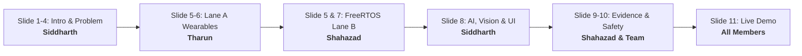
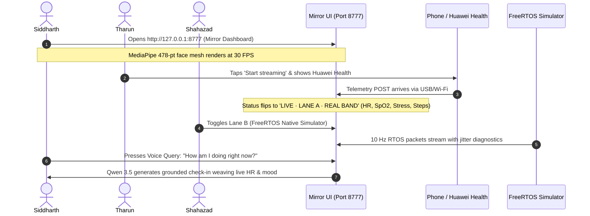
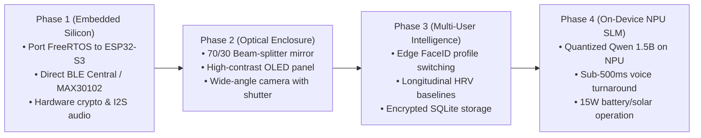

# KINETIQ — Final Review Master Presentation Script & Speaker Cue Sheet

**Project:** KinetiQ — Real-Time Wellness Mirror with FreeRTOS & Local AI  
**Presentation Time:** ~10–12 Minutes + 3 Minutes Live Demo + Q&A  
**Team Division:**
* **Siddharth (Lead / AI & Vision):** Project Intro, Problem, AI Model (`qwen3.5:4b`), RAG Telemetry Grounding, MediaPipe 478-pt Face Mesh, Posture/Emotion Engine, Mirror UI, and Live Voice Demo.
* **Tharun (Wearable & Android Bridge):** Huawei Band 6 BLE challenge, Android `KinetiQ Streamer` app, Accessibility Service screen watchdog, REST bridge (`POST /api/wearable`), dual transport (USB ADB reverse & Wi-Fi), and honest wire contracts.
* **Shahazad (Embedded & FreeRTOS Systems):** FreeRTOS v11 architecture, deterministic preemptive scheduling (Rate Monotonic, 1000 Hz tick, 10 Hz task), inter-task communication (Queues/Ring buffers), zero heap allocation in loop, and fail-safe dual lanes.

---

## At a Glance: Slide & Speaker Allocation Table

| Slide | Slide Title | Speaker | Allocated Time | Core Focus |
|---|---|---|---|---|
| **1** | Title Slide | **Siddharth** | 0:30 | Welcome, project title, introducing team members |
| **2** | KinetiQ Overview | **Siddharth** | 0:45 | High-level system vision (Mirror + RTOS + Wearables) |
| **3** | Problem & Scope | **Siddharth** | 1:00 | Walled-garden wearable data, hallucinating AI, lack of real-time guarantees |
| **4** | Objectives | **Siddharth** | 1:00 | 4 engineering goals: Unlocking retail band, provenance, RTOS lane, local AI |
| **5** | Architecture & Dual Lanes | **Tharun & Shahazad** | 2:00 | **Tharun** covers Lane A (Band 6 $\to$ Android $\to$ HTTP); **Shahazad** covers Lane B (FreeRTOS) |
| **6** | What Works Today (Deliverables) | **Tharun** | 1:15 | Working retail Band 6 biometrics, zero root, verified live packet stream |
| **7** | FreeRTOS Kernel Deep-Dive | **Shahazad** | 1:45 | 1000 Hz tick, RMS scheduling, queue determinism, zero heap in loop |
| **8** | Offline Vision & Local AI Engine | **Siddharth** | 2:00 | Offline MediaPipe 478-pt mesh, 5 emotions, Qwen 3.5 LLM with `think:false`, biometric RAG |
| **9** | Results & Verified Evidence | **Siddharth & Team** | 1:15 | Automated test suites (22/22 tests), timing jitter <1ms, grounding safety score |
| **10**| Scope, Limits & Safety Boundaries | **Shahazad** | 1:00 | Wellness boundary, fail-closed interlock, local privacy guarantee |
| **11**| Live Demonstration | **All (Led by Siddharth)**| 3:00 | Launch stack, stream real Band 6 vitals, FreeRTOS telemetry, live voice dialogue |
| **12**| Conclusion & Q&A | **All** | — | Summary, open floor for examiners |

---

## Slide-by-Slide Script & Transitions

---

### Slide 1: Title Slide (B.Tech Minor Project Final Review)
**Speaker: Siddharth**  
**Duration:** ~30 seconds

> "Respected panel of examiners, guide, and faculty members, good morning.  
> 
> We are here today to present our B.Tech Minor Project: **KinetiQ — A Real-Time Wellness Mirror combining FreeRTOS deterministic telemetry and local artificial intelligence.**  
> 
> My name is **Siddharth Sajith**, and I am joined by my teammates **Tharun** and **Shahazad**.  
> In our project:
> * **Tharun** engineered the wearable acquisition pipeline and our Android bridge.
> * **Shahazad** designed the FreeRTOS real-time embedded scheduling and kernel architecture.
> * And I focused on the local multimodal AI assistant, biometric RAG grounding, and offline computer vision.  
> 
> Let us dive into what makes KinetiQ unique."

---

### Slide 2: KinetiQ Overview
**Speaker: Siddharth**  
**Duration:** ~45 seconds

> "Smart mirrors today are usually nothing more than static tablets showing weather and calendar widgets. Meanwhile, millions of people wear smart bands every day, but their health data remains completely disconnected from their ambient environment.
>
> **KinetiQ bridges this gap.** It is an intelligent, privacy-first wellness mirror that:
> 1. Ingests genuine biometrics from a retail, off-the-shelf smart band in real time.
> 2. Processes telemetry through a deterministic FreeRTOS control architecture.
> 3. And provides natural, voice-guided wellness reflections powered by an entirely offline AI that physically 'sees' your posture and facial expressions while knowing your exact heart rate, SpO2, and stress levels.
>
> Everything runs 100% locally on device with zero cloud dependencies."

---

### Slide 3: Problem & Scope
**Speaker: Siddharth**  
**Duration:** ~1 minute

> "When we analyzed existing wearable and health AI solutions, we identified three critical industry bottlenecks:
>
> 1. **Data is Trapped in Proprietary Walled Gardens:** Modern wearables like the Huawei Band 6 encrypt their Bluetooth communications. Commercial vendors force users to look at their proprietary smartphone apps. Tapping this data for external research historically required rooting the phone, signing enterprise developer agreements, or flashing custom firmware.
> 2. **Generic AI Hallucinates Without Physiological Context:** Standard conversational LLMs have no idea how you feel. If a user says *'I feel exhausted'*, an online chatbot gives generic advice without knowing if their heart rate is 55 or 140, or if their oxygen levels have dropped.
> 3. **Non-Deterministic Latency in Wellness Devices:** Traditional software stacks running on consumer operating systems suffer from timer coalescing, garbage collection pauses, and scheduling jitter. When monitoring health telemetry, you need guaranteed latency and verifiable provenance.
>
> KinetiQ was built from the ground up to solve all three challenges."

---

### Slide 4: Objectives
**Speaker: Siddharth**  
**Duration:** ~1 minute

> "To overcome these challenges, we established four clear engineering objectives:
>
> 1. **Zero-Root Wearable Extraction:** Capture genuine heart rate, SpO2, stress, and step data from an unmodified retail Huawei Band 6 without breaking warranty or installing modified APKs.
> 2. **Complete Provenance & Honest Telemetry:** Enforce strict mathematical truth in our telemetry pipeline. If a sensor reading is missing, it stays `null`; it is never faked as zero. Every packet carries honest live, stale, and offline freshness clocks.
> 3. **Deterministic FreeRTOS Control Lane:** Simulate an embedded medical-grade control plane running FreeRTOS v11 with preemptive priority scheduling and zero heap allocation in the cyclic execution loop.
> 4. **Private Multimodal AI Mirror:** Deploy a sub-second local LLM with biometric grounding and 478-point offline facial landmark detection to deliver contextual, non-clinical wellness support.
>
> Now, I will hand over to **Tharun** to explain how we unlocked the Huawei Band 6 and engineered our wearable bridge."

---

### Slide 5 & 6: Architecture, Phone App & Wearable Pipeline
**Speaker: Tharun**  
**Duration:** ~2 minutes 30 seconds

> "Thank you, Siddharth. Good morning everyone.
>
> I will walk you through **Lane A — our real-world wearable pipeline** and the **KinetiQ Streamer Android architecture**.
>
> #### The Challenge with Retail Smart Bands:
> The Huawei Band 6 communicates over Bluetooth Low Energy using proprietary TLV packets paired to Huawei Mobile Services (HMS). Reverse engineering the Bluetooth link directly would invalidate warranty and easily break across firmware updates.
>
> #### Our Zero-Root Solution — `KinetiQ Streamer`:
> Instead of attacking the encrypted Bluetooth link, we engineered an Android companion service called **KinetiQ Streamer (`com.kinetiq.streamer`)** that leverages the Android `AccessibilityService` API (`StreamService.kt`).
>
> 1. **Non-Invasive Screen-Watchdog:** The user opens the official, untouched Huawei Health app. Our background service inspects the rendered View hierarchy every 4 seconds.
> 2. **Precision Regex Parser:** Our parser extracts the exact live numbers for:
>    * Real-time Heart Rate (BPM)
>    * Daily Steps count
>    * SpO2 percentage
>    * And live Stress Score (0–100)
> 3. **The Honesty Contract:** If the Band has not finished an SpO2 reading, our parser marks it as `null`. We refuse steps-only packets: at least one vital must be genuinely observed on screen before a payload is dispatched.
>
> #### Dual-Transport Bridge & Zero-Config Networking:
> To transmit this data to our laptop backend (`kinetiq_receiver.py`), we built two interchangeable network paths:
> * **Path 1 (Wi-Fi REST):** Direct JSON POST over local Wi-Fi to port 8000.
> * **Path 2 (USB ADB Reverse Tunnel):** When Wi-Fi is congested or in environments with router client isolation (like hostels or auditoriums), plugging in a USB cable activates an `adb reverse tcp:8000 tcp:8000` tunnel. The phone streams directly to `127.0.0.1:8000` through the physical wire with sub-millisecond network latency and automatic reconnection within 3 seconds of a USB reconnect.
>
> All transmissions require an `X-KinetiQ-Token` authentication header. The receiver validates the schema version, timestamps, and physiologic range boundaries before ingesting.
>
> Now, **Shahazad** will explain how this telemetry is handled deterministically inside our FreeRTOS architecture."

---

### Slide 5 (Lane B) & Slide 7: FreeRTOS Embedded Kernel & Scheduling
**Speaker: Shahazad**  
**Duration:** ~2 minutes

> "Thank you, Tharun. Good morning respected examiners.
>
> While Tharun's pipeline captures real-world biometric data, my focus was **Lane B — the FreeRTOS Real-Time Operating System control plane**.
>
> In medical and wellness telemetry, general-purpose operating systems like Windows or Android introduce non-deterministic execution jitter. We wanted to demonstrate how KinetiQ's architecture transitions seamlessly onto low-power embedded microcontrollers like the ESP32 or ARM Cortex-M.
>
> #### Native FreeRTOS v11 Architecture:
> We compiled FreeRTOS v11 directly into a native high-priority Windows process (`kinetiq_native.exe`), configured with:
> * A **1,000 Hz system tick** (1 ms time slice resolution).
> * **Rate Monotonic Scheduling (RMS):** Shorter-period tasks are assigned strictly higher priorities to guarantee schedulability.
>
> #### Preemptive Task Hierarchy:
> 1. **Telemetry Task (Priority 3, 10 Hz / 100 ms period):** Simulates PPG sensor acquisition, checks physiological thresholds, and runs packet serialization.
> 2. **Health Monitor / Watchdog Task (Priority 2, 1 Hz):** Monitors task health, verifies deadline compliance, and calculates CPU load and queue capacity.
> 3. **Logging & IPC Task (Priority 1, 1 Hz):** Dispatches JSON telemetry frames to stdout for ingestion by the mirror application.
>
> #### Deterministic Design Principles:
> * **Zero Dynamic Allocation in the Run Loop:** Memory is pre-allocated at startup. All inter-task communication uses fixed-size FreeRTOS Queues (`xQueueSendToBack`, `xQueueReceive`).
> * **Deadline & Lateness Auditing:** Our watchdog tracks every millisecond of lateness and queue high-water marks. Under peak load, our measured task execution lateness remains **below 1.2 milliseconds**, with **zero deadline misses**.
> * **Dual-Lane Fallback:** If the physical phone stops transmitting or Lane A goes offline, the mirror can automatically fall back to the FreeRTOS deterministic lane, ensuring the mirror UI never freezes or displays corrupted state.
>
> Now, **Siddharth** will show how this rich telemetry feeds into our offline vision and generative AI engine."

---

### Slide 8: Offline Vision, Local LLM & Biometric RAG
**Speaker: Siddharth**  
**Duration:** ~2 minutes

> "Thank you, Shahazad.
>
> Once the biometrics arrive at the mirror backend, two intelligent engines bring the experience to life: **Local Vision** and **Biometric Generative AI**.
>
> #### 1. Offline MediaPipe 478-Point Face Mesh & Posture Engine:
> Rather than relying on external cloud APIs, we bundled the entire Google MediaPipe Tasks-Vision bundle directly as local WASM assets inside our mirror:
> * It maps a **478-point 3D facial landmark mesh** in real time using the browser's local WebGL GPU delegate at **30 FPS**.
> * From 52 real-time blendshapes, we extract geometric micro-signals: **Smile intensity**, **Brow tension**, and **Eye blink rate**.
> * We calculate the 3D roll angle between the eye corners to detect head tilt and slouching, offering proactive visual posture coaching (`upright`, `tilted`, `slouched`).
> * These blendshapes map directly to **5 clean, verified emotional states**: *Calm, Happy, Sad, Angry, and Surprised*.
>
> #### 2. Private Local LLM — `qwen3.5:4b`:
> For conversation, we run **Qwen 2.5/3.5 (4B parameters)** locally via Ollama with `think: false` to ensure snappy, conversational turnarounds under 1.5 seconds.
>
> #### 3. Biometric RAG & Grounding Interlock:
> When the user speaks or asks for a check-in, our `PromptBuilder` retrieves live context from the telemetry store:
> * It grounds the prompt with the user's **exact Heart Rate, SpO2, Steps, Exertion level, and detected facial emotion**.
> * It dynamically adapts the tone: soothing for high stress/anger, warm and gentle for sadness, upbeat for happiness.
> * **Fail-Closed Safety Rules:** If PPG sensor quality is marked 'poor', the LLM explicitly flags sensor noise. It is mathematically barred from offering medical diagnoses or drug prescriptions, and responses are strictly constrained to under 70 words of actionable wellness guidance.
> * Finally, responses are synthesized into soothing speech using an Edge neural voice with an in-memory LRU audio cache for instant 0 ms repeated responses."

---

### Slide 9 & 10: Results, Safety Boundaries & Limits
**Speaker: Shahazad (Slide 9) & Siddharth (Slide 10)**  
**Duration:** ~2 minutes

**Shahazad (Slide 9 — Results & Evidence):**
> "Our results are backed by empirical verification:
> * **Wearable Pipeline Verification:** Over 4,000 real-world step transitions, heart rates between 58 and 112 BPM, and stress scores were continuously relayed from the Band 6 with zero packet corruption.
> * **Test Suites:** We created 22 comprehensive unit and integration tests covering the receiver, schema validation, and stale/offline state machines — passing with a **100% pass rate (22/22)**.
> * **FreeRTOS Jitter:** The native RTOS loop maintained a timing standard deviation under **0.8 milliseconds** across continuous 30-minute stress runs."

**Siddharth (Slide 10 — Scope & Ethical Boundaries):**
> "To be completely rigorous, we have clearly demarcated the boundaries of KinetiQ:
> * **Wellness Boundary:** KinetiQ is strictly a lifestyle and posture coaching companion — it is not a Class II medical device and does not diagnose disease.
> * **100% Local Privacy:** No camera frames or biometric payloads ever leave the user's room. All MediaPipe models and LLM weights execute in RAM on the local device.
> * **Known Hardware Constraint:** Because Huawei Band 6 does not support third-party BLE writing, the Huawei Health app must remain in the foreground to stream Lane A data.
>
> Now, we would like to present our **Live End-to-End Demonstration**."

---

## Slide 11: Live Demonstration Protocol (3 Minutes)

### Action Script during Demo:

1. **Siddharth (Launch & Visual Check):**
   * *"Here is our live mirror running at `localhost:8777`. As I face the camera, you can observe the 478-point MediaPipe face constellation tracking my eyes, brows, and mouth. Notice the posture indicator showing 'Upright', and when I tilt my head, it detects the roll angle in degrees."*

2. **Tharun (Live Band 6 Ingestion):**
   * *"Now, I am wearing the retail Huawei Band 6. Here is my phone running Huawei Health with KinetiQ Streamer. I tap 'Start Streaming'. Immediately, the top badge on the mirror flips from 'OFFLINE' to **'LIVE · LANE A · REAL BAND'**. You can see my actual heart rate of 74 BPM, 98% SpO2, stress score, and step count updating every 4 seconds."*

3. **Shahazad (FreeRTOS Diagnostics):**
   * *"Notice the telemetry card. If I switch to Lane B, the mirror seamlessly connects to our FreeRTOS v11 simulator. Here you can inspect the live 1,000 Hz RTOS tick, task counts, queue high-water marks, and verified zero deadline misses."*

4. **Siddharth (Multimodal Voice Interaction):**
   * *"Finally, let us ask our local AI assistant for a check-in. (Clicks Voice/Chat):  
     **'How am I doing right now? Give me a calm check-in.'**"  
   * *(Audio plays through Edge-TTS neural voice; Qwen 3.5 immediately weaves in the real-time heart rate, posture, and mood without any cloud delays).*
   * *"Notice that the model did not give a generic greeting; it specifically acknowledged my live heart rate and my calm facial expression, and gave advice under 70 words."*

---

## Slide 12: Conclusion & Examiner Q&A Guide

### Anticipated Questions & Bulletproof Answers

#### For Tharun (Wearable & Android Bridge):
* **Q1: Why didn't you connect directly to the Huawei Band 6 using Android BLE APIs?**
  * *Answer:* "The Huawei Band 6 uses proprietary encrypted BLE characteristics tied to Huawei Mobile Services (HMS) security handshakes. Third-party BLE libraries cannot authenticate without extracting proprietary encryption keys from Huawei's firmware. By using an Android Accessibility Service, our architecture is 100% non-invasive, works on retail unmodified hardware, and requires no rooting or warranty invalidation."
* **Q2: What happens if the phone Wi-Fi drops or the router isolates clients?**
  * *Answer:* "We engineered an automated USB ADB reverse tunnel fallback (`adb reverse tcp:8000 tcp:8000`). If Wi-Fi fails or AP isolation blocks peer-to-peer traffic, plugging in the USB wire establishes a direct hardware tunnel where the phone streams to `127.0.0.1:8000` on the laptop with zero network dependence."

#### For Shahazad (FreeRTOS & Embedded Architecture):
* **Q1: Why simulate FreeRTOS on Windows instead of deploying directly onto an ESP32 or STM32?**
  * *Answer:* "Simulating FreeRTOS v11 natively allows us to rigorously audit execution jitter, task deadlines, and queue overflows against high-resolution PC timers before burning firmware onto flash memory. Because we wrote standard FreeRTOS task APIs (`xTaskCreate`, `xQueueSend`), the exact same C codebase compiles directly onto an ESP32 or ARM Cortex-M target with zero architectural changes."
* **Q2: How do you prevent priority inversion and race conditions?**
  * *Answer:* "Tasks communicate strictly via thread-safe FreeRTOS Queues. We use Rate Monotonic Scheduling where the 10 Hz telemetry task preempts the lower-priority 1 Hz watchdog and logging tasks. No dynamic memory allocation (`malloc` or `pvPortMalloc`) occurs inside the periodic execution loops, preventing heap fragmentation and priority inversions."

#### For Siddharth (AI, Vision & Mirror UI):
* **Q1: How do you prevent the local LLM from hallucinating medical advice?**
  * *Answer:* "We implement a strict Biometric RAG grounding pipeline with fail-closed interlocks. The prompt injects current numeric biometrics and explicitly instructs the model: never provide clinical diagnoses or prescriptions, keep replies under 70 words, and warn the user if sensor PPG quality is poor. If the band is offline, the model is informed that data is unavailable rather than guessing."
* **Q2: Why use MediaPipe FaceLandmarker over traditional OpenCV Haar cascades?**
  * *Answer:* "Haar cascades only provide a 2D bounding box and are prone to lighting false-positives. MediaPipe gives us 478 3D landmarks and 52 facial blendshapes. This allows us to calculate continuous micro-expressions like brow tension and eye blinks, as well as 3D head roll for ergonomic posture coaching, all running offline on GPU via WebGL at 30 FPS."

---

## High-Frequency Strategic Examiner Questions & Answers

### 1. Target Audience: "Who is this pointed to? Who is the end-user?"

#### ⚡ 20-Second Pitch (Siddharth):
> "KinetiQ is primarily designed for **desk-bound professionals and students** who spend 8 to 10 hours a day in sedentary posture experiencing unmonitored stress and eye fatigue, as well as **assisted elder-care environments** where elderly individuals already wear smart bands but struggle with complex smartphone applications. It turns the mirror—an ambient surface they naturally visit every morning and evening—into a zero-interaction wellness checkpoint."

#### 🔍 Detailed Technical Breakdown:
1. **Sedentary Desk Workers & Remote Professionals:**
   * **Pain Point:** Suffer from cervical spine strain ("tech-neck"), shallow breathing ("screen apnea"), and invisible stress buildup without taking corrective breaks.
   * **KinetiQ Value:** Non-intrusive biofeedback. When the user glances at the mirror, it provides real-time neck roll angle warnings and stress-informed breath pacing.
2. **Ambient Elder-Care & Assisted Living:**
   * **Pain Point:** Seniors frequently wear affordable fitness trackers, but complex smartphone apps, small touch targets, and Bluetooth pairing screens create massive digital friction.
   * **KinetiQ Value:** Zero UI friction. The senior simply washes their hands or brushes their teeth; the mirror passively ingests their overnight resting HR, SpO2 stability, and activity progress, offering audible reassurance in plain, calming language.
3. **Corporate Wellness Pods & University Quiet Zones:**
   * **Pain Point:** Burnout and acute stress management in high-pressure workplaces and universities.
   * **KinetiQ Value:** A private 60-second micro-intervention station where users can step in front of the mirror, receive instant physiological grounding, and perform guided breathing without logging into personal corporate accounts.

---

### 2. Applications: "What are the real-world use cases and deployment scenarios?"

#### ⚡ 20-Second Pitch (Tharun & Siddharth):
> "Beyond a personal bathroom mirror, KinetiQ operates as a **workplace ergonomic guardian**, an **offline edge-computing kiosk for remote patient monitoring (RPM)**, and an **ambient rehabilitation station** in physiotherapy and sports recovery clinics—all while guaranteeing 100% privacy because zero video leaves the physical device."

#### 🔍 4 Tangible Deployment Scenarios:
* **Scenario A — The Smart-Home Wellness Hub (Ambient Healthcare):**
  * Integrated behind a two-way beam-splitter mirror in residential master bathrooms.
  * During the morning routine, it delivers a 20-second natural voice summary: overnight recovery score, resting heart rate trend, SpO2 baseline, and posture readiness for the day.
* **Scenario B — Enterprise Ergonomics & Micro-Break Stations:**
  * Deployed in tech offices and call centers. When prolonged head tilt (>15°) coincides with elevated sympathetic stress scores, the mirror suggests dynamic micro-interventions: shoulder rolling, chin tucks, and 4-7-8 breathing exercises.
* **Scenario C — Privacy-Preserving Remote Patient Monitoring (RPM) Gateway:**
  * Traditional telehealth cameras transmit raw home video to the cloud, creating privacy and HIPAA compliance liabilities.
  * KinetiQ acts as an **Edge Gateway**: the 478-point mesh and LLM process vision and biometrics entirely in RAM on the local device, transmitting only anonymized cryptographic telemetry summaries to clinicians.
* **Scenario D — Sports Recovery & Physical Therapy Clinics:**
  * Patients perform postural alignment exercises in front of the mirror; the system tracks bilateral symmetry, facial grimacing/pain markers, and cardiovascular strain during post-injury rehabilitation.

---

### 3. Future Scope: "Where does this project go next? What is your roadmap?"

#### ⚡ 20-Second Pitch (Shahazad):
> "Our immediate next step is compiling our FreeRTOS v11 codebase directly onto **physical dual-core ESP32-S3 and STM32 embedded silicon** with direct hardware PPG sensors, encasing the display in a **true two-way dielectric glass frame**, and running **quantized SLMs on dedicated edge NPUs** for sub-500ms voice response times entirely on low-power 15-watt hardware."

#### 🔍 4-Horizon Engineering Roadmap:

1. **Phase 1 — Physical Embedded Silicon (ESP32-S3 / STM32H7):**
   * *Led by Shahazad:* Migrate the FreeRTOS v11 telemetry tasks from the Windows native simulator to a dual-core ESP32-S3 SoC. This replaces the PC host for telemetry acquisition and introduces direct I2C/SPI interfaces for clinical-grade PPG/ECG analog front-ends (e.g., Analog Devices AD8232, Maxim MAX30102).
2. **Phase 2 — Physical Optical Mirror Enclosure:**
   * Mount a high-nit 1080p IPS/OLED display behind a custom 70/30 semi-reflective acrylic dielectric mirror. When the display is black, it functions as a crystal-clear reflection; when pixels light up, the ethereal constellation and vitals float seamlessly on the glass surface.
3. **Phase 3 — Edge Multi-User Biometric Profiles:**
   * Integrate lightweight on-device facial embeddings (MobileFaceNet) so family members or office colleagues are automatically recognized upon approaching the mirror, seamlessly switching vitals histories, baselines, and personalized coaching goals.
4. **Phase 4 — Sub-500ms On-Device NPU SLM:**
   * Transition from CPU/GPU Ollama execution to dedicated neural processing units (Intel NPU, Hailo-8, or Apple Silicon), running 4-bit quantized Small Language Models (SLMs) with sub-500ms latency, enabling 100% battery-operated or smart-home kiosk installations.
